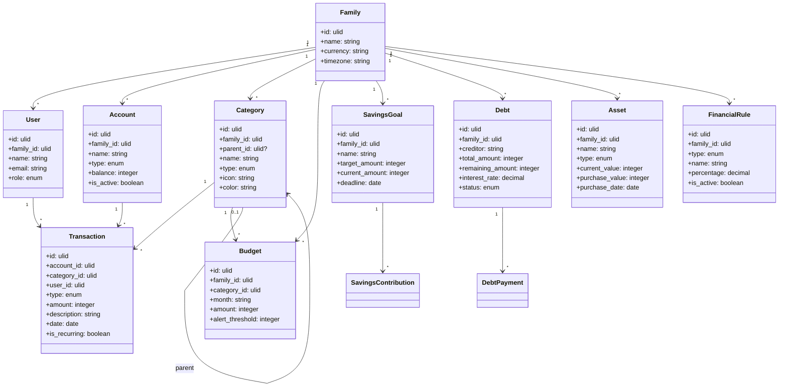

# FAMFIN — Domain Model

## Entidades de Domínio

---

## Agregados

| Agregado | Root | Entidades Filhas |
|----------|------|-----------------|
| Family | Family | Users |
| Account | Account | Transactions |
| Budget | Budget | — |
| Savings | SavingsGoal | SavingsContribution |
| Debt | Debt | DebtPayment |
| Asset | Asset | — |

---

## Value Objects

| Value Object | Usado em | Descrição |
|-------------|----------|-----------|
| Money | Transaction, Budget, etc. | Valor em centavos |
| DateRange | Budget, Report | Período de datas |
| Percentage | FinancialRule, Debt | Percentual |

---

## Enums

| Enum | Valores |
|------|---------|
| TransactionType | income, expense, transfer |
| AccountType | checking, savings, investment, wallet, credit_card |
| CategoryType | income, expense |
| DebtStatus | active, paid, overdue |
| AssetType | property, vehicle, investment, other |
| UserRole | admin, member, viewer |
| RuleType | tithe, inss, yield, custom |

---

*Última atualização: 2026-09-29*
