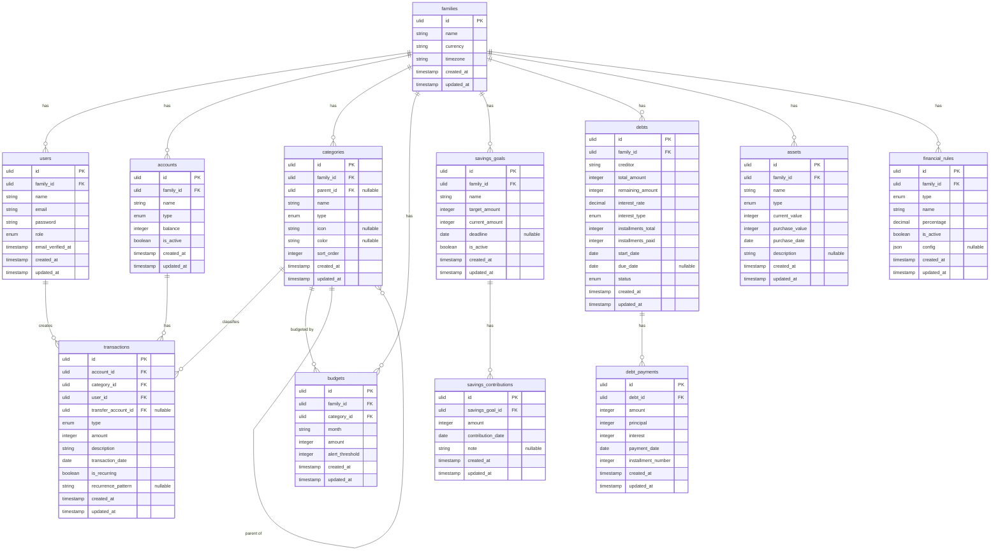

# FAMFIN — Entity Relationship Diagram

## ERD

---

## Notas

- Todos os IDs usam ULID (ordenável por tempo)
- Todos os valores monetários em centavos (integer)
- `transfer_account_id` em transactions: apenas para tipo `transfer`
- `parent_id` em categories: permite hierarquia de categorias
- `config` em financial_rules: JSON para parâmetros específicos do tipo de regra

---

*Última atualização: 2026-09-29*
